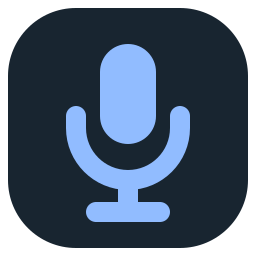
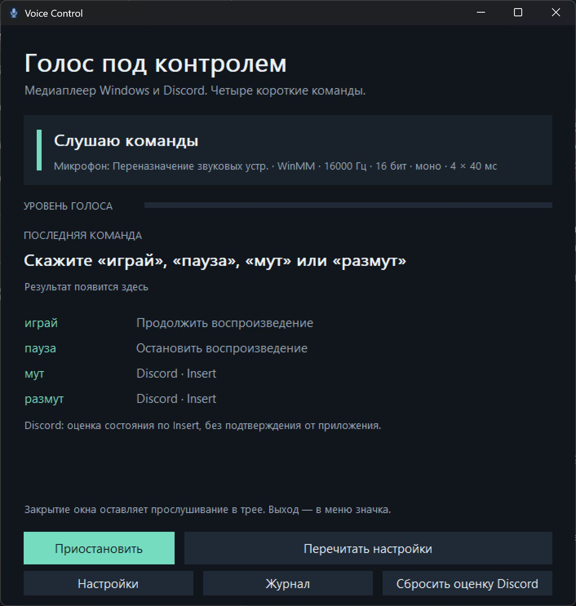
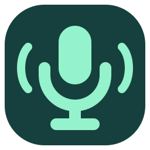

<p align="center"></p>

# Voice Control

**Голосовые команды для медиаплеера Windows и микрофона Discord.**

Нативное приложение на Rust: скажите «пауза», чтобы остановить видео, или «мут», чтобы переключить микрофон Discord. Распознавание работает локально на компьютере. Поддерживаются Windows 10/11 x64, системный трей и чёткое масштабирование интерфейса на 4K.

[](https://github.com/K0LLIAK94/voice-control-rs/actions/workflows/windows.yml)
[](LICENSE)

**[Скачать готовую сборку для Windows x64](https://github.com/K0LLIAK94/voice-control-rs/releases/latest/download/VoiceControl-windows-x64.zip)** · [Все релизы](https://github.com/K0LLIAK94/voice-control-rs/releases) · [Сообщить об ошибке](https://github.com/K0LLIAK94/voice-control-rs/issues)

## Команды

| Сказать | Действие |
| --- | --- |
| **играй** / **продолжи** | Play текущей медиасессии Windows |
| **пауза** / **поставь на паузу** | Pause; повтор не возобновляет видео |
| **мут** / **выключи микрофон** | Отправить Insert в Discord |
| **размут** / **включи микрофон** | Отправить Insert в Discord |

## Запуск

1. Скачайте `VoiceControl-windows-x64.zip` из [последнего релиза](https://github.com/K0LLIAK94/voice-control-rs/releases/latest).
2. Распакуйте архив целиком и запустите **`voice-control.exe`**. Модель и DLL оставьте в папках `models` и `runtime` рядом с EXE.
3. В Discord назначьте глобальную клавишу **Insert → переключить микрофон**. Запустите видео или музыку, чтобы появилась системная медиасессия Windows.

Установка, Rust, Python, Node и .NET для запуска не требуются. Готовый архив содержит распознаватель и русскую модель. После распаковки интернет для распознавания не нужен.

Окно показывает микрофон, уровень сигнала и последнюю команду. Крестик сворачивает в трей; выход находится в меню значка. **Приостановить** освобождает микрофон. Автозагрузка не включается автоматически. Если Windows запрещает доступ к микрофону, разрешите его для классических приложений.



**Discord:** Insert переключает состояние. Приложение показывает отправку клавиши и локальную оценку, поскольку фактический статус микрофона Discord ему недоступен. Начните с известного состояния Discord; после ручного переключения нажмите **Сбросить оценку Discord**. Повтор одной команды не отправляет повторный Insert, пока локальная оценка уже совпадает с ней.

## Что восстановлено из Laitis

Исследован именно переданный `Laitis.exe` 6.7.6.4 с помощью REA. Восстановлены путь захвата WinMM `waveIn*`, PCM 16000 Гц / signed 16 bit / mono, четыре буфера по 40 мс, предзапись, подготовка и завершение фраз. Подробности, токены методов и границы доказательств: [отчёт реверса](analysis/laitis-report.md).

Это самостоятельная реализация нужных голосовых сценариев, не полная копия всех функций Laitis. Основной распознаватель оригинала обращался к старому Google full-duplex API. Здесь используется [Vosk](https://github.com/alphacep/vosk-api) и [локальная русская модель](https://alphacephei.com/vosk/models); звук не отправляется в интернет. Встроенные ключи и код оригинала не перенесены. Уровень PCM измеряется по абсолютной амплитуде; особенность старого измерителя Laitis с положительным старшим байтом намеренно исправлена.

## Настройки

Кнопка **Настройки** открывает `config.toml`. После сохранения нажмите **Перечитать настройки**. Пустое `microphone` означает микрофон Windows по умолчанию. Для выбора другого используйте точное имя из `voice-control-cli.exe --list-devices`.

Интерфейс учитывает DPI каждого монитора, в том числе 4K при 150–200% в Windows. Дополнительный масштаб: **Ctrl + плюс**, **Ctrl + минус**, **Ctrl + 0** для сброса. Он сохраняется как `ui_scale_percent` в `config.toml`; настройка не меняет параметры микрофона и распознавания.

Списки `commands` задают произносимые фразы. Модель хранит «размут» как два слова `раз мут`; произносить можно слитно. Неизвестное модели слово вызывает понятную ошибку при загрузке вместо молчаливого игнорирования. `ignored_phrases` позволяет отличать похожие слова и отрицания от команд. `min_confidence` и `cooldown_ms` управляют порогом и защитой от дублей. Однословные команды могут случайно встретиться в разговоре или звуке динамиков; для шумного окружения замените их более длинными фразами.

Звук и произвольные разговоры не сохраняются. Журнал содержит действия и ошибки, ограничен по размеру. При разрыве микрофона приложение пробует переподключиться. Распознавание и системные действия отделены от потока захвата звука.

## Значок

| Ожидание | Слышу речь |
| :---: | :---: |
|  |  |

Собственные SVG: [ожидание](assets/icon-idle.svg) и [слышу голос](assets/icon-speaking.svg). Их ICO-версии встроены в EXE и окно; значок в трее автоматически переключается по состоянию детектора речи. Во время паузы используется спокойный значок. Исходники SVG можно менять и заново экспортировать в ICO перед сборкой.

## Сборка из исходников

Нужны Rust stable x64 и соответствующий toolchain: MSVC с Visual Studio C++ Build Tools / Windows SDK либо GNU с MinGW (включая `windres.exe` в PATH). Выполнять в PowerShell из корня проекта:

```powershell
git clone https://github.com/K0LLIAK94/voice-control-rs.git
cd voice-control-rs
.\scripts\bootstrap.ps1             # проверенные по SHA256 Vosk DLL и модель
cargo build --release --locked --bins
cargo test --locked
.\scripts\test-speech.ps1 -Executable .\target\release\voice-control-cli.exe
.\scripts\package.ps1 -SkipBuild
```

Звуковой тест использует установленный Windows-голос **Microsoft Irina Desktop** и не выполняет системных действий. Он проверяет реальные PCM WAV через VAD, Vosk и маршрутизацию. Проверка живого голоса, конкретного фильма и фактического микрофона Discord должна проводиться отдельно; синтетические записи её не доказывают.

```powershell
.\target\release\voice-control-cli.exe --self-check
.\target\release\voice-control-cli.exe --status
.\target\release\voice-control-cli.exe --recognize-file .\tests\audio\play.wav --json
.\target\release\voice-control-cli.exe --console --dry-run --run-for 15
```

`--recognize-file`, `--status` и `--self-check` не отправляют медиакоманды/Insert. `--self-check` кратко открывает микрофон и проверяет получение PCM. Без `--dry-run` обычное прослушивание выполняет распознанные команды.

Сборка, Clippy, тесты и упаковка выполняются также в [Windows CI](https://github.com/K0LLIAK94/voice-control-rs/actions/workflows/windows.yml). Подробные результаты локальных проверок: [validation](docs/validation/README.md).

## Структура проекта

- `src/winmm.rs`, `src/vad.rs` — захват звука и выделение фраз.
- `src/recognizer.rs`, `src/commands.rs` — Vosk и маршрутизация команд.
- `src/windows_controls.rs` — медиасессии Windows и Insert.
- `src/ui.rs`, `src/ui_scale.rs` — нативное окно, трей и DPI.
- `assets/` — SVG/ICO-значки; `scripts/` — загрузка модели, упаковка и звуковые тесты.

## Зависимости и исследовательские материалы

Исходный код проекта распространяется по [MIT](LICENSE). Лицензии Vosk, модели и других компонентов перечислены в [THIRD_PARTY_NOTICES](THIRD_PARTY_NOTICES.md).

Проприетарный EXE, извлечённые DLL, полные дампы REA, записи микрофона, модели, сборки и журналы исключены из Git. В репозитории находятся собственные исходники, воспроизводимые скрипты, тесты и очищенный отчёт исследования. Готовая сборка с открытым распознавателем и моделью публикуется отдельно в Releases.
